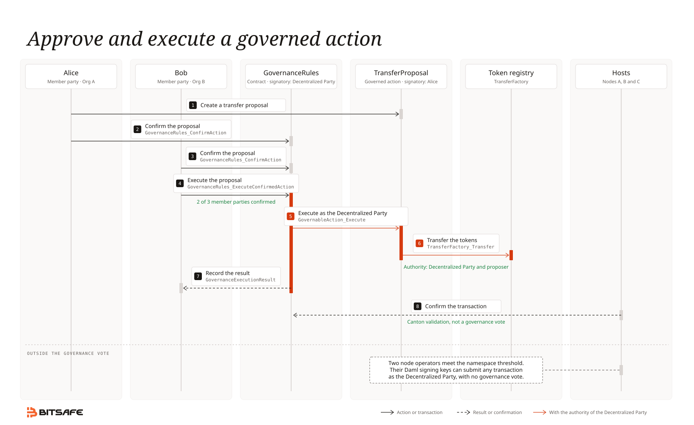

# How Decentralization Manager works

Decentralization Manager lets several organizations control one Canton party together. This page explains the parts of that setup and how they connect. The parts are participant nodes, parties, three thresholds and the `GovernanceRules` contract. Read this page before the other concept pages.

## Glossary

| Term | Meaning |
|---|---|
| Participant node | A Canton server that one organization runs. It stores contracts and validates transactions for the parties that it hosts. A participant node is infrastructure, not a party. Other pages also call it a participant or a member node. |
| Decentralization Manager node | The Decentralization Manager application that one organization runs next to its participant node. The Decentralization Manager nodes of the organizations coordinate workflows with each other. |
| Canton party | An identity on the ledger. A party can sign contracts and exercise choices, but only through the participant nodes that host it. |
| Signatory | A party that must authorize a contract. A contract cannot exist without the authority of all its signatories. |
| Controller | A party that can exercise a choice on a contract. A choice runs with the authority of the signatories of the contract and the controllers of the choice. |
| Host | A participant node that hosts a party. The host stores the contracts of the party and confirms its transactions. Decentralization Manager gives each host of the Decentralized Party Confirmation permission. With this permission, a host can confirm transactions for the party, but it cannot submit them. |
| Namespace owner | A participant node whose namespace key can sign topology changes for the Decentralized Party. A topology change adds or removes a host, changes a key, or changes the namespace threshold or the confirmation threshold. |
| Daml signing key | A key that each participant node holds for the Decentralized Party. Enough Daml signing keys to meet the namespace threshold can sign a transaction as the Decentralized Party. Other pages also call it the Daml key. The code stores these keys in `PartyToParticipant.party_signing_keys`. |
| Decentralized Party | The Canton party that the organizations control together. No single participant node can act for it. The Daml code calls it `governanceParty`. |
| Member party | A Canton party that one organization uses to propose, confirm and execute governed actions. `GovernanceRules.members` lists the member parties. A member party is not a participant node, and it holds no Daml signing key. Other pages also call it a governance member. |
| Proposer | The party that creates a proposal. The proposer is a member party or an additional proposer. An additional proposer can propose, but it cannot confirm. The code calls these parties `proposer` and `additionalProposers`. |
| Executor | The member party that executes a proposal after enough member parties confirm it. The code calls it `executor`. |
| `GovernanceRules` | The Daml contract that lists the member parties and the governance threshold. The Decentralized Party is its signatory. |
| Governed action | A proposal contract that implements the `GovernableAction` interface. Its `executeImpl` function holds the action to run. |
| Governance vote | The process in which member parties confirm a proposal. The vote passes when the confirmations meet the governance threshold. Each confirmation is a `GovernanceConfirmation` contract. |

## Participant nodes, member parties and the Decentralized Party

Each organization runs one participant node. Together, the participant nodes host the Decentralized Party and own its namespace. Each participant node also hosts the member party of its organization.

| Organization | Participant node | Member party |
|---|---|---|
| Org A | Node A | Alice |
| Org B | Node B | Bob |
| Org C | Node C | Carol |

Node A hosts Alice, Node B hosts Bob, and Node C hosts Carol. All three participant nodes also host the Decentralized Party.

The two types of party do different work:

- The Decentralized Party is the signatory of the shared contracts. Examples are `GovernanceRules` and the assets that the organizations hold together.
- A member party proposes, confirms and executes governed actions.

The operator of each participant node controls its Daml signing key. On a JCE participant node, the key is in the vault of the participant node. On an AWS KMS participant node, each signature needs the `kms:Sign` permission. A member party has no control over any key.

## The three thresholds

A Decentralized Party has three thresholds. Each threshold counts a different thing, and one threshold does not replace another. Canton stores the first two thresholds in the topology of the party. `GovernanceRules` stores the third threshold.

| Threshold | Name in the UI | Field | What it counts | What it controls | Default value |
|---|---|---|---|---|---|
| Namespace threshold | Threshold | `DecentralizedNamespaceDefinition.threshold` | Signatures from namespace owners | Each topology change | The operator sets it when they create the party |
| Confirmation threshold | Confirmation Threshold | `PartyToParticipant.threshold` | Hosts that confirm | Each transaction that needs the approval of the Decentralized Party. This includes each governed action | The namespace threshold. An operator can set a different value at creation or with **Change Threshold** |
| Governance threshold | Gov Threshold | `GovernanceRules.threshold` | Confirmations from member parties | The execution of a governed action | Deploy Contracts copies the namespace threshold into it. After that, it changes separately from the other two thresholds |

A transaction submitted as the Decentralized Party needs Daml signing keys from enough participant nodes to meet the namespace threshold. Canton stores a copy of this value in `PartyToParticipant.party_signing_keys.threshold`. Decentralization Manager always keeps the copy equal to the namespace threshold.

Decentralization Manager writes the namespace threshold and the confirmation threshold in [`thresholds.rs`](https://github.com/DLC-link/decentralization-manager/blob/v1.14.0/crates/decman/src/workflow/thresholds.rs#L1-L57). It copies the governance threshold in [`prepare.rs`](https://github.com/DLC-link/decentralization-manager/blob/v1.14.0/crates/decman/src/workflow/contracts/steps/prepare.rs#L199-L216).

### Recommended setup

- Give each organization one participant node and one member party. Then each threshold counts organizations, and no organization counts twice.
- Keep the namespace threshold and the confirmation threshold at or above the governance threshold. If one of them is lower, fewer node operators than a governance vote needs can act for the Decentralized Party. Canton's [decentralization guide](https://github.com/digital-asset/canton/blob/main/docs-open/src/sphinx/overview/explanations/canton/decentralization.rst#decentralized-validation) gives the same advice for the confirmation threshold.

Deploy Contracts copies the namespace threshold into `GovernanceRules`. If no operator set a different confirmation threshold, the three thresholds are then equal. Decentralization Manager does not check the thresholds after deployment. Two types of change can break the recommendation:

- A governance vote raises the governance threshold above the namespace threshold or the confirmation threshold. After this change, run **Change Threshold** to raise the lower thresholds.
- A kick or a **Change Threshold** run lowers the namespace threshold or the confirmation threshold below the governance threshold.

Check the three thresholds after each change to the member parties, the participant nodes or a threshold.

## Why `GovernanceRules` exists

Readers often ask this question: if enough Daml signing keys can already sign as the Decentralized Party, why use `GovernanceRules`?

Canton does not accept a normal command from a party whose confirmation threshold is more than 1. If Canton accepted such a command, one participant node could act alone for the party. Canton gives two other ways to act for the party ([Canton docs](https://github.com/digital-asset/canton/blob/main/docs-open/src/sphinx/overview/explanations/canton/decentralization.rst#submissions-for-decentralized-parties)):

1. External signing. Enough Daml signing keys of the party sign each transaction.
2. Authorization in Daml. The party is the signatory of a contract. Other parties control the choices of that contract, and the contract sets how many of them must agree.

`GovernanceRules` uses the second way. The `DsoRules` contract of Canton Coin uses the same pattern ([Canton docs](https://github.com/digital-asset/canton/blob/main/docs-open/src/sphinx/participant/howtos/operate/parties/multi-sig-in-canton.rst)). Decentralization Manager uses the first way only in the Deploy Contracts workflow.

`GovernanceRules` also does these things, which key signatures alone cannot do:

- Member parties confirm at different times. Each confirmation is a `GovernanceConfirmation` contract on the ledger.
- Each action has a type. Each action is a template that implements `GovernableAction`, and the member parties confirm its exact fields.
- Confirmations expire. Each confirmation has an `expiresAt` time.
- Only listed parties can propose. The list holds the member parties and the `additionalProposers`.
- Each execution creates a `GovernanceExecutionResult` contract as an audit record.
- The member parties are separate from the Daml signing keys. A governance vote can change the member parties without a topology change.

## How an approved action gets its authority

The steps below follow one governed action from its execution to the end of its Canton transaction.

1. The Decentralized Party is the signatory of `GovernanceRules` ([`Rules.daml`](https://github.com/DLC-link/decentralization-manager/blob/v1.14.0/daml/governance-core/daml/Governance/Rules.daml#L152-L186)).
2. A member party exercises `GovernanceRules_ExecuteConfirmedAction`. The member party is the controller of this choice. Decentralization Manager submits the command as the member party, and it reads the contracts of the Decentralized Party ([`commands.rs`](https://github.com/DLC-link/decentralization-manager/blob/v1.14.0/crates/decman-lib/src/framework/commands.rs#L15-L32)).
3. The choice runs with the authority of the Decentralized Party, because the Decentralized Party is the signatory of `GovernanceRules`. The choice checks three things: the executor is a member party, each confirmation is current, and enough member parties confirmed ([`Rules.daml`](https://github.com/DLC-link/decentralization-manager/blob/v1.14.0/daml/governance-core/daml/Governance/Rules.daml#L450-L487)).
4. The choice exercises `GovernableAction_Execute` on the proposal. The Decentralized Party is the controller of that choice, and its authority is already present ([`Action.daml`](https://github.com/DLC-link/decentralization-manager/blob/v1.14.0/daml/governance-action-v1/daml/Governance/Action.daml#L37-L40)).
5. `executeImpl` runs with the authority of the Decentralized Party and of the proposer. The proposer's authority is present because the proposer is the signatory of each built-in proposal. Each action must therefore check that its target contracts belong to the Decentralized Party. [`CreateTransferRule.daml`](https://github.com/DLC-link/decentralization-manager/blob/v1.14.0/daml/governance-utility-onboarding/daml/Governance/UtilityOnboarding/CreateTransferRule.daml#L34-L40) shows the check, and [Custom Daml templates](https://github.com/DLC-link/decentralization-manager/blob/main/docs/CUSTOM_DAML_TEMPLATES.md) explains it.
6. `GovernanceRules` creates a `GovernanceExecutionResult` ([`ExecutionResult.daml`](https://github.com/DLC-link/decentralization-manager/blob/v1.14.0/daml/governance-core/daml/Governance/ExecutionResult.daml#L18-L33)).
7. The hosts of the Decentralized Party confirm the full transaction. Canton needs confirmations from enough hosts to meet the confirmation threshold. This step is Canton validation, not a governance vote.

A governed action needs no signature from a Daml signing key.

A self-management action changes `GovernanceRules` itself, for example its threshold. It has no proposal contract. Member parties confirm it with `GovernanceRules_ConfirmGovernanceAction` and execute it with `GovernanceRules_ExecuteGovernanceAction`. The [Governance lifecycle](https://docs.bitsafe.finance/decentralization-manager/concepts-and-development/governance-lifecycle) page describes both types of action.

## Paths outside the governance vote

Some actions do not go through a governance vote. The Decentralized Party is therefore only as protected as its lowest threshold.

- **Deploy Contracts.** This workflow submits a transaction as the Decentralized Party. It therefore needs Daml signing keys from enough participant nodes to meet the namespace threshold. Each Decentralization Manager node signs only a transaction that creates the contracts in the invitation that it accepted. No other Decentralization Manager workflow submits as the Decentralized Party ([`prepare.rs`](https://github.com/DLC-link/decentralization-manager/blob/v1.14.0/crates/decman/src/workflow/contracts/steps/prepare.rs#L140-L152), [`sign.rs`](https://github.com/DLC-link/decentralization-manager/blob/v1.14.0/crates/decman/src/workflow/contracts/steps/sign.rs#L277-L322)).
- **Direct submission with Daml signing keys.** Operators who control enough Daml signing keys to meet the namespace threshold can submit any transaction as the Decentralized Party. They need no Decentralization Manager workflow and no governance vote. For example, they can exercise `GovernanceRules_SetThreshold`, `GovernanceRules_AddMemberAndSetThreshold` or `GovernableAction_Execute`. The Decentralized Party is the controller of these three choices ([`Rules.daml`](https://github.com/DLC-link/decentralization-manager/blob/v1.14.0/daml/governance-core/daml/Governance/Rules.daml#L196-L240), [`Action.daml`](https://github.com/DLC-link/decentralization-manager/blob/v1.14.0/daml/governance-action-v1/daml/Governance/Action.daml#L37-L40)). The test [`testGovernancePartyCanStillCancel`](https://github.com/DLC-link/decentralization-manager/blob/v1.14.0/daml/governance-core-test/daml/Governance/Test/ConfirmationTest.daml#L221) shows that the Decentralized Party can also cancel a proposal directly.
- **Colluding hosts.** Hosts can work together against the rules. If enough of them meet the confirmation threshold, they can approve any transaction for the Decentralized Party. They can do this without valid signatures from the Daml signing keys. Canton's [decentralization guide](https://github.com/digital-asset/canton/blob/main/docs-open/src/sphinx/overview/explanations/canton/decentralization.rst#decentralized-validation) and [external party guide](https://github.com/digital-asset/canton/blob/main/docs-open/src/sphinx/overview/explanations/canton/external-party.rst) describe this risk.
- **Topology change through Canton.** Enough namespace owners to meet the namespace threshold can change the topology directly through Canton. For example, they can add a host, replace the Daml signing keys or lower a threshold.
- **A second `GovernanceRules` contract.** The template has no contract key, so two active `GovernanceRules` contracts can exist. Only Deploy Contracts or a direct submission as the Decentralized Party can create a second contract. Decentralization Manager reads the first active contract that it finds, and it shows no warning ([`queries.rs`](https://github.com/DLC-link/decentralization-manager/blob/v1.14.0/crates/decman/src/server/queries.rs#L1117)). Proposals and confirmations do not identify a specific `GovernanceRules` contract.
- **Proposer cancel.** A proposer can cancel their own proposal with `GovernableAction_ProposerCancel`. The cancellation needs no governance vote ([`Action.daml`](https://github.com/DLC-link/decentralization-manager/blob/v1.14.0/daml/governance-action-v1/daml/Governance/Action.daml#L52-L53)).

## Worked example: a token transfer

Three organizations each run a participant node. Alice, Bob and Carol are their member parties. Each of the three thresholds is 2 of 3, and these values follow the recommended setup. Two of the three member parties must therefore confirm a proposal.

Text version of the diagram:

1. Org A sends `POST /governance/propose` to its Decentralization Manager node. Decentralization Manager creates a `TransferProposal`, with Alice as the proposer and signatory ([`TransferProposal.daml`](https://github.com/DLC-link/decentralization-manager/blob/v1.14.0/daml/governance-token-custody/daml/Governance/TokenCustody/TransferProposal.daml#L37-L70)).
2. In the same request, Decentralization Manager confirms the proposal as Alice with `GovernanceRules_ConfirmAction` ([`governance.rs`](https://github.com/DLC-link/decentralization-manager/blob/v1.14.0/crates/decman/src/server/handlers/governance.rs#L1160)).
3. Org B sends `POST /governance/confirm`. Decentralization Manager confirms the proposal as Bob. Each confirmation is a `GovernanceConfirmation` contract, not a key signature.
4. Org B sends `POST /governance/execute`. Decentralization Manager exercises `GovernanceRules_ExecuteConfirmedAction` as Bob. Two confirmations meet the governance threshold, so Carol does not need to confirm.
5. `GovernanceRules` exercises `GovernableAction_Execute` with the authority of the Decentralized Party.
6. `executeImpl` exercises `TransferFactory_Transfer`. Decentralization Manager sets the Decentralized Party as the sender of the transfer.
7. `GovernanceRules` creates a `GovernanceExecutionResult`.
8. The hosts confirm the transaction under the confirmation threshold. This step is Canton validation, not a governance vote. Steps 4 to 7 are one Canton transaction.

Below the dashed line, the diagram shows one path outside the governance vote. Two node operators meet the namespace threshold. With their Daml signing keys, they can submit a transaction as the Decentralized Party directly. [Paths outside the governance vote](#paths-outside-the-governance-vote) lists the other paths.

## Reference

Code:

- [`Rules.daml`](https://github.com/DLC-link/decentralization-manager/blob/v1.14.0/daml/governance-core/daml/Governance/Rules.daml): `GovernanceRules` and its confirm and execute choices.
- [`Action.daml`](https://github.com/DLC-link/decentralization-manager/blob/v1.14.0/daml/governance-action-v1/daml/Governance/Action.daml): the `GovernableAction` interface.
- [`Confirmation.daml`](https://github.com/DLC-link/decentralization-manager/blob/v1.14.0/daml/governance-core/daml/Governance/Confirmation.daml): the `GovernanceConfirmation` contract.
- [`ExecutionResult.daml`](https://github.com/DLC-link/decentralization-manager/blob/v1.14.0/daml/governance-core/daml/Governance/ExecutionResult.daml): the audit record.
- [`TransferProposal.daml`](https://github.com/DLC-link/decentralization-manager/blob/v1.14.0/daml/governance-token-custody/daml/Governance/TokenCustody/TransferProposal.daml): the action in the worked example.
- [`thresholds.rs`](https://github.com/DLC-link/decentralization-manager/blob/v1.14.0/crates/decman/src/workflow/thresholds.rs): the code that writes the namespace threshold and the confirmation threshold.

Repository docs:

- [Architecture overview](https://github.com/DLC-link/decentralization-manager/blob/main/docs/ARCHITECTURE.md)
- [Custom Daml templates](https://github.com/DLC-link/decentralization-manager/blob/main/docs/CUSTOM_DAML_TEMPLATES.md)

Public docs: [docs.bitsafe.finance/decentralization-manager](https://docs.bitsafe.finance/decentralization-manager).

Canton docs:

- [Decentralization](https://github.com/digital-asset/canton/blob/main/docs-open/src/sphinx/overview/explanations/canton/decentralization.rst)
- [Multi-sig in Canton](https://github.com/digital-asset/canton/blob/main/docs-open/src/sphinx/participant/howtos/operate/parties/multi-sig-in-canton.rst)
- [External parties](https://github.com/digital-asset/canton/blob/main/docs-open/src/sphinx/overview/explanations/canton/external-party.rst)
